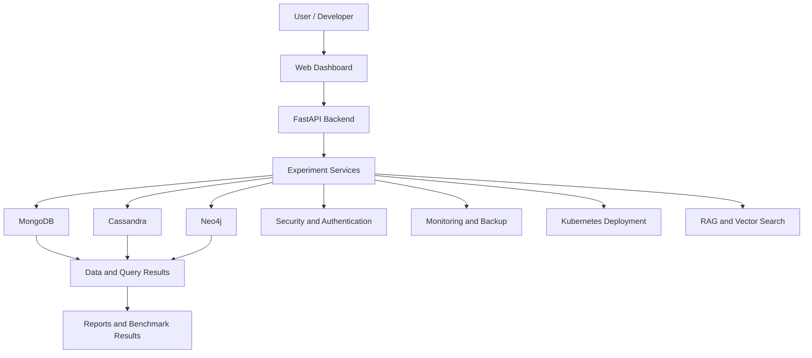

 
# NoSQL Integrated Laboratory

<p align="center">
  <strong>A Practical Exploration of NoSQL Database Design, Performance, Security, Scalability and Distributed Data Systems</strong>
</p>

<p align="center">
  
  
  
  
</p>

## Overview

The **NoSQL Integrated Laboratory** is a hands-on collection of 18 experiments designed to explore modern NoSQL database technologies and their applications in real-world systems.

The project progresses from fundamental NoSQL concepts and MongoDB document modelling to advanced topics such as replication, sharding, transaction management, security, high availability, multi-tenancy, polyglot persistence, vector search and cross-database performance analysis.

It combines practical database implementations, Python-based automation, REST APIs, Docker-based infrastructure, monitoring, benchmarking and technical documentation.

The objective is not simply to understand how NoSQL databases work, but to evaluate **which database model is appropriate for a particular workload, how it behaves under different conditions, and how it can be operated reliably at scale.**

## Project Highlights

- **18 practical experiments** covering database fundamentals through advanced distributed systems.
- MongoDB document modelling, CRUD operations, indexing, replication, transactions and sharding.
- Cassandra wide-column data modelling and query-driven table design.
- Neo4j graph modelling, relationship traversal and community analysis.
- FastAPI-based application and integration services.
- Docker-based deployment profiles for isolated experiment environments.
- Authentication, role-based access control, TLS and tenant isolation.
- Backup, restore, monitoring and operational verification.
- Retrieval-Augmented Generation (RAG) with vector search and a local language model.
- Comparative database benchmarking using a reproducible synthetic threat-intelligence dataset.

## Technology Stack

| Category | Technologies |
|---|---|
| Programming | Python |
| Primary database | MongoDB |
| Wide-column database | Apache Cassandra |
| Graph database | Neo4j |
| Backend APIs | FastAPI |
| API communication | REST, HTTP |
| Database drivers | PyMongo, Cassandra Python Driver, Neo4j Python Driver |
| Containerization | Docker, Docker Compose |
| Orchestration | Kubernetes |
| Authentication | JWT, MongoDB RBAC |
| Security | TLS, certificates, key-file authentication |
| Monitoring | MongoDB metrics, exporter, operational scripts |
| AI and retrieval | FastEmbed, MongoDB Atlas Vector Search, Ollama |
| Documentation | Markdown, Mermaid |

---

# Experiment Catalogue

The experiments are organized into four learning stages.

| Stage | Experiments | Focus |
|---|---:|---|
| Foundations | 01–06 | NoSQL concepts, modelling, CRUD and indexing |
| Distributed MongoDB | 07–11 | Schema design, replication, consistency, transactions and sharding |
| Production Engineering | 12–15 | Security, high availability, monitoring, backup and multi-tenancy |
| Advanced Data Systems | 16–18 | Polyglot persistence, RAG, vector search and database benchmarking |

## Stage 1 — NoSQL Foundations

### Experiment 01 — Database Classification and NoSQL Families

**Objective:** Study the major NoSQL database families and classify database products according to their underlying data models.

**Key concepts:**
- Document databases
- Key-value databases
- Wide-column databases
- Graph databases
- Primary and secondary data models
- Database use-case selection

**Implementation:** Reviewed database products, classified their dominant storage models, documented common use cases and completed a classification activity.

**Outcome:** Developed an understanding of how different NoSQL database families represent and access data.

### Experiment 02 — Application Data-Domain Mapping

**Objective:** Map application data domains to suitable NoSQL database families.

**Key concepts:**
- Data access patterns
- Data structure and relationships
- Read/write requirements
- Database selection

**Implementation:** Evaluated application domains such as user profiles, ride history, real-time tracking and relationship data. Mapped them to appropriate database technologies.

**Recorded result:** Six domain mappings were inserted successfully.

**Outcome:** Demonstrated how application requirements influence database selection.

### Experiment 03 — Embedded and Referenced Document Modelling

**Objective:** Compare embedded and referenced document relationships in MongoDB.

**Key concepts:**
- One-to-one relationships
- One-to-many relationships
- Many-to-many relationships
- Embedding versus referencing
- Document growth and BSON limits

**Implementation:** Created equivalent embedded and referenced representations using a post-and-comments example and compared how the data was retrieved.

**Observation:** Embedded documents can retrieve related information in a single query, while referenced designs may require additional queries or aggregation.

**Outcome:** Implemented and compared both document modelling approaches.

### Experiment 04 — Product Query API and Inventory CRUD

**Objective:** Implement MongoDB product queries and inventory CRUD operations using Python.

**Key concepts:**
- Create, Read, Update and Delete
- Query filters
- Comparison operators
- Upsert operations
- Bulk updates

**Implementation:** Connected to MongoDB, loaded product data, executed price-based queries and performed inventory operations.

**Recorded result:** Seven products were inserted in the saved Product Query API run.

**Outcome:** Practised database interaction and inventory management using Python and MongoDB.

### Experiment 05 — Order and Product Data Modelling

**Objective:** Explore document modelling and query patterns using order and product datasets.

**Key concepts:**
- Document structure
- Order-oriented modelling
- Bucket-style representation
- Data grouping
- Query-driven design

**Implementation:** Loaded order and product JSON datasets, executed the two modelling activities and compared the resulting document structures.

**Outcome:** Explored how document shape should support the application's expected read and write operations.

### Experiment 06 — Index Design and Index Strategies

**Objective:** Study MongoDB index design and evaluate how indexing strategies affect query execution.

**Key concepts:**
- Single-field indexes
- Compound indexes
- Index field ordering
- Query execution plans
- Index storage and write overhead

**Implementation:** Created indexes for selected query patterns and inspected query-plan output to understand index usage.

**Outcome:** Demonstrated why indexes should be designed around actual application filters and sorting requirements rather than added indiscriminately.

---

## Stage 2 — Distributed MongoDB Systems

### Experiment 07 — Production Schema Design and Working-Set Analysis

**Objective:** Analyze MongoDB schema relationships and evaluate working-set behaviour under random reads.

**Key concepts:**
- Production-oriented schema design
- Embedding and referencing
- BSON document size
- Working-set behaviour
- WiredTiger cache
- Random-read workloads

**Implementation:**
- Analysed CTI sample data.
- Compared embedded and referenced structures.
- Performed an embedded redesign.
- Generated a 100,000-document working set.
- Executed random-read workloads and monitored cache statistics.

**Recorded sample:** 100,000 documents inserted in 15.36 seconds. The captured cache-hit ratio increased from 82.09% to 100% in later samples.

**Outcome:** Explored how schema design and memory caching influence database workload behaviour.

### Experiment 08 — Replica-Set Monitoring, Failover and Priority

**Objective:** Configure and observe MongoDB replica-set behaviour, including member health, election priority and failover.

**Key concepts:**
- Primary and secondary members
- Replica-set configuration
- Election priority
- Arbiter
- Automatic failover
- Replication health

**Implementation:** Configured and inspected the `rs0` replica set, executed replication and failover observation scripts and verified member health.

**Recorded result:** Three healthy data-bearing members and one healthy arbiter.

**Outcome:** Demonstrated MongoDB replication architecture and the role of elections in maintaining availability.

### Experiment 09 — Write Concern and Network Partition

**Objective:** Evaluate write acknowledgement and durability under normal connectivity and a simulated network partition.

**Key concepts:**
- Write concern
- `w=1`
- Majority acknowledgement
- Network partitions
- Durability
- Cluster recovery

**Implementation:** Compared write acknowledgement behaviour under different connectivity conditions, simulated a controlled partition and restored the cluster.

**Recorded result:** A `w=1` write succeeded in the tested connected state, while a majority write timed out when only the primary remained available. All nodes were subsequently restored and verified healthy.

**Outcome:** Demonstrated the relationship between write concern, durability and replica-set availability.

### Experiment 10 — Transactions and Concurrent Inventory Reservation

**Objective:** Demonstrate transaction behaviour and consistency for multi-document operations and concurrent inventory updates.

**Key concepts:**
- Multi-document transactions
- Commit and rollback
- Data consistency
- Concurrent operations
- Inventory reservation

**Implementation:** Executed transaction-transfer operations and concurrent inventory reservation activities using a replica-set deployment.

**Recorded status:** Both Lab 10 activities were marked as passed in the dashboard history.

**Outcome:** Demonstrated how transactions maintain consistency across related database operations.

### Experiment 11 — Shard-Key Analysis and Hotspot Demonstration

**Objective:** Compare shard-key distribution and demonstrate the impact of monotonically increasing keys.

**Key concepts:**
- MongoDB sharding
- Range-based shard keys
- Hashed shard keys
- Chunk distribution
- Write hotspots
- Horizontal scalability

**Implementation:** Deployed a dedicated sharded-cluster topology, inserted sequential-key records, inspected shard distribution and compared the results with hashed-key distribution.

**Recorded result:**

| Strategy | Shard distribution |
|---|---|
| Sequential range key | Concentrated on one shard |
| Hashed key | 5,073 records / 4,927 records |

**Outcome:** Demonstrated how shard-key selection influences workload distribution and helps prevent hotspots.

---

## Stage 3 — Production Engineering and Security

### Experiment 12 — MongoDB RBAC and TLS Security

**Objective:** Implement role-based access control and secure MongoDB connections using TLS.

**Key concepts:**
- Authentication
- Role-based access control
- User permissions
- TLS encryption
- Certificates
- Secure database communication

**Implementation:** Configured a dedicated MongoDB security instance, created role-based access rules and tested authorized and unauthorized operations. Configured TLS certificates and tested encrypted connections.

**Recorded result:** RBAC checks passed, the plain connection was rejected and the TLS client connection succeeded.

**Outcome:** Demonstrated database access restrictions and encrypted client-server communication.

### Experiment 13 — Authenticated High Availability and Kubernetes

**Objective:** Demonstrate authenticated MongoDB replication, metrics exposure and StatefulSet deployment.

**Key concepts:**
- Replica-set internal authentication
- Key-file authentication
- High availability
- Metrics exporter
- Kubernetes StatefulSets
- Persistent volume claims

**Implementation:**
- Configured a three-member authenticated replica set.
- Verified primary and secondary states.
- Checked exporter metrics.
- Deployed a MongoDB StatefulSet with persistent storage.
- Verified pod health and storage claims.

**Recorded result:** Authenticated one-primary/two-secondary replica set, exporter returned HTTP 200, and the three-member Kubernetes StatefulSet was reported healthy with bound PVCs.

**Outcome:** Explored authenticated database replication and container orchestration with persistent storage.

### Experiment 14 — MongoDB Monitoring and Automated Backup/Restore

**Objective:** Monitor MongoDB operational metrics and verify that backups can be restored correctly.

**Key concepts:**
- Connection metrics
- Database operations
- WiredTiger cache metrics
- Replica-set monitoring
- `mongodump`
- `mongorestore`
- Backup retention

**Implementation:** Collected operational metrics, generated timestamped backups, restored a test collection and compared the restored records with expected values.

**Recorded result:**

| Measurement | Result |
|---|---:|
| Documents restored | 1,000 |
| Backup time | 0.004 seconds |
| Restore time | 0.030 seconds |
| Restore verification | True |

**Outcome:** Demonstrated backup creation, restoration and data verification.

### Experiment 15 — Multi-Tenant API, Access Control and Migration

**Objective:** Implement a tenant-aware task API and migrate shared records into tenant-specific collections.

**Key concepts:**
- Multi-tenancy
- JWT authentication
- Role-based permissions
- Tenant isolation
- CRUD operations
- Rate limiting
- TTL-based expiry

**Implementation:** Built a FastAPI task-management service with tenant-scoped operations, administrator and user permissions, rate limiting and tenant-specific data migration.

**Recorded result:**

| Metric | Result |
|---|---:|
| Tasks seeded | 500 |
| Users | 10 |
| Migration | 100 tasks per tenant in the documented workflow |
| Cross-tenant leaks | 0 |

**Outcome:** Demonstrated tenant-aware data access and validation of isolation between users and tenants.

---

## Stage 4 — Advanced Data Systems

### Experiment 16 — Polyglot Persistence and Hybrid Query Service

**Objective:** Model and query related information across MongoDB, Cassandra and Neo4j using a unified service.

**Key concepts:**
- Polyglot persistence
- Document databases
- Wide-column databases
- Graph databases
- Hybrid queries
- Connection pooling
- Circuit breakers

**Implementation:** Developed a hybrid service using MongoDB, Cassandra and Neo4j. The project includes university and fraud-analysis use cases, database-specific models and API operations that combine information across systems.

**Recorded implementation:** The experiment report records 100,000 threat records seeded and verified in each database, with a read-only hybrid search endpoint.

**Outcome:** Explored how multiple database models can work together through a unified application layer.

### Experiment 17 — RAG Pipeline and Vector Index Benchmarking

**Objective:** Build a retrieval-augmented generation workflow and compare vector-index strategies.

**Key concepts:**
- Retrieval-Augmented Generation
- Text chunking
- Embeddings
- Vector similarity search
- MongoDB Atlas Vector Search
- Conversation memory
- Retrieval evaluation

**Implementation:**
- Prepared and chunked a cybersecurity knowledge base.
- Generated 384-dimensional embeddings using FastEmbed and `all-MiniLM-L6-v2`.
- Stored vectors and conversation memory in MongoDB Atlas.
- Retrieved relevant context through vector search.
- Used Qwen3:4B through Ollama to generate answers.
- Evaluated vector retrieval using a separate benchmark.

**Recorded benchmark:** 5,000 vectors and 100 queries.

**Outcome:** Demonstrated how vector retrieval can provide relevant context to a language model for cybersecurity question answering.

### Experiment 18 — Cross-Database Threat Intelligence Benchmark

**Objective:** Compare MongoDB, Cassandra and Neo4j for a common threat-intelligence workload.

**Key concepts:**
- Cross-database benchmarking
- Synthetic threat-intelligence data
- Query latency
- Insert throughput
- Graph relationships
- Campaign analysis
- Cross-source correlation

**Implementation:**
- Generated a reproducible dataset of 100,000 synthetic threat records.
- Imported the records into MongoDB, Cassandra and Neo4j.
- Designed document, query-driven wide-column and graph data models.
- Executed repeated benchmark queries.
- Analysed shared synthetic campaigns and cross-source relationships.
- Compared query latency and insert throughput.

**Dataset:** 100,000 synthetic records, 16 sources, seven threat types and 10,000 synthetic campaigns.

**Query performance — median latency**

| Query category | MongoDB | Cassandra | Neo4j |
|---|---:|---:|---:|
| Threat history | 0.454 ms | 2.023 ms | 15.139 ms |
| Target analysis | 0.451 ms | 1.866 ms | 28.889 ms |
| Daily threat volume | 58.088 ms | 4.316 ms | 67.996 ms |

**Insert throughput — median**

| Database | Records per second |
|---|---:|
| MongoDB | 242,739.95 |
| Cassandra | 23,648.29 |
| Neo4j | 60,957.13 |

**Graph analysis:**
- 100,000 threat nodes
- 16 source nodes
- 10,000 campaign nodes
- 200,000 relationships
- 100 cross-source campaign results inspected

**Key observations:**
- MongoDB performed strongly on the tested threat-history and target queries.
- Cassandra performed strongly on the daily-volume query because the experiment used a precomputed aggregate table.
- Neo4j provided relationship-oriented analysis through campaign and source connections.
- Shared synthetic campaigns represent potential relationships, not confirmed real-world attribution or proven false positives.

**Benchmark limitations:** Results were obtained on a local environment. Write implementations differed between databases, and the daily-volume queries did not perform identical work. These measurements are workload-specific and should not be treated as universal database performance rankings.

**Outcome:** Demonstrated how database choice affects query performance, ingestion behaviour and relationship analysis in a common synthetic threat-intelligence workload.

---

# Architecture

The project combines individual database experiments with application and infrastructure components.



The architecture is modular: each experiment has its own purpose, configuration and data requirements. Database namespaces and deployment profiles are used to keep experiment workloads isolated.

## Repository Structure

The following is a conceptual overview. Actual paths and filenames may vary depending on the experiment implementation.

```text
NoSQL-Integrated-Lab/
│
├── backend/
│   ├── main.py
│   └── database.py
│
├── frontend/
│   └── index.html
│
├── experiments/
│   ├── exp01/
│   ├── exp02/
│   ├── exp03/
│   ├── exp04/
│   ├── exp05/
│   ├── exp06/
│   ├── exp07/
│   ├── exp08/
│   ├── exp09/
│   ├── exp10/
│   ├── exp11/
│   ├── exp12/
│   ├── exp13/
│   ├── exp14/
│   ├── exp15/
│   ├── exp16/
│   ├── exp17/
│   └── exp18/
│
├── docker/
│
├── reports/
│
├── docker-compose.yml
│
└── README.md
```

## Dashboard and API Integration

The integrated dashboard provides a centralized interface for accessing experiment information, operational status and results.

The main application uses FastAPI, with individual experiment services where applicable.

Examples of experiment-specific API routes include:

| Experiment | Example endpoint |
|---|---|
| 7 | `/api/exp7/status` |
| 8 | `/api/exp8/status` |
| 9 | `/api/exp9/results` |
| 10 | `/api/exp10/summary` |
| 11 | `/api/exp11/summary` |
| 12 | `/api/exp12/status` |
| 13 | `/api/exp13/status` |
| 14 | `/api/exp14/central-status` |
| 15 | `/api/exp15/status` |
| 16 | `/api/exp16/status` |
| 17 | `/api/exp17/status` |
| 18 | `/api/exp18/summary` |

These are documented integration routes; individual endpoints may require their corresponding services and configuration to be running.

## Deployment

Docker and Docker Compose are used to manage isolated database and application environments.

For the integrated experiment deployment profiles, the launcher supports:

| Command | Experiments |
|---|---|
| `demo-a` | 7–10, 12 |
| `demo-b` | 11 |
| `demo-c` | 13–14 |
| `demo-d` | 15–16 |
| `demo-e` | 17–18 |

The launcher also supports:

```bash
./demo.sh demo-status
./demo.sh demo-stop
```

Run commands from the directory containing the launcher. Check the relevant experiment README and environment configuration before starting a profile.

**Important configuration notes:**
- Experiment 17 requires valid MongoDB Atlas configuration and an available Ollama model service.
- Experiment 18 requires its MongoDB, Cassandra and Neo4j services.
- Kubernetes experiments require a working Kubernetes environment.
- Do not assume all profiles can run simultaneously; resource requirements differ.

## Setup

### 1. Clone the repository

```bash
git clone <YOUR_GITHUB_REPOSITORY_URL>
cd NoSQL-Integrated-Lab
```

### 2. Configure environment variables

Create the required `.env` file using the environment template supplied by the project, if available.

Configure database connection strings, credentials, ports and application settings for the experiment you intend to run.

Do not commit credentials, private keys, certificates or local environment files.

### 3. Start the required services

Use the relevant Docker Compose configuration or experiment launcher.

```bash
docker compose up -d
```

This is a general Compose example. Some experiments use separate Compose files or deployment profiles.

### 4. Verify services

```bash
docker ps
```

Check the relevant experiment's health endpoint and logs before running its scripts.

## Engineering Practices

The project applies several practical engineering principles:

- **Isolation:** Experiment-specific databases, keyspaces, collections and deployment profiles reduce interference between activities.
- **Reproducibility:** Scripts and datasets provide repeatable experiment workflows.
- **Verification:** Database counts, query responses, health checks and restore validation are used to inspect results.
- **Security:** Credentials are separated from source code, with authentication and TLS demonstrated in dedicated experiments.
- **Observability:** Monitoring and benchmark outputs provide evidence of system behaviour.
- **Documentation:** Each experiment has a defined objective, implementation approach and recorded outcome.

## Key Learnings

Across the 18 experiments, the project demonstrates that:

1. NoSQL database selection should be based on data structure and application access patterns.
2. Embedding and referencing involve trade-offs in query count, document growth and update behaviour.
3. Indexes improve selected read patterns but introduce storage and write-maintenance costs.
4. Replica sets provide redundancy, while write concern determines acknowledgement requirements.
5. Transactions support consistency across related operations.
6. Shard-key selection has a direct impact on data distribution and write hotspots.
7. Authentication, TLS and tenant isolation are important production requirements.
8. Backup and restore workflows must be verified, not merely scheduled.
9. Polyglot persistence allows different databases to serve different access patterns.
10. Vector search and RAG combine database retrieval with language-model generation.
11. Benchmark results must be interpreted in the context of workload design, environment and measurement methodology.

## Limitations and Interpretation

- Results are specific to the configurations and workloads used in each experiment.
- Synthetic data is not equivalent to production threat intelligence.
- Local benchmark measurements do not establish distributed-cluster performance.
- Estimated scaling behaviour must be distinguished from measured results.
- Some experiments require external services, credentials or additional infrastructure.
- A documented implementation or saved result does not imply that its services are currently running.

## Future Enhancements

Potential directions for extending the laboratory include:

- Automated experiment execution and validation.
- More controlled, repeatable benchmark workloads.
- Distributed multi-node performance testing.
- Expanded monitoring dashboards and alerting.
- Automated backup recovery testing.
- Additional database query and indexing comparisons.
- More extensive RAG evaluation using retrieval quality and answer-grounding metrics.

## Conclusion

The NoSQL Integrated Laboratory brings together 18 practical experiments covering the lifecycle of modern NoSQL systems—from fundamental data modelling to distributed architecture, security, operational reliability and intelligent data retrieval.

By implementing and comparing multiple database technologies, the project demonstrates that database engineering is not about choosing one technology for every problem. It is about understanding the workload, selecting the right data model, measuring actual behaviour and building reliable systems around it.

---

## Author

**K. Nideesh Reddy**  
Department of Computer Science and Engineering  
JAIN (Deemed-to-be University)

**Course:** NoSQL Databases / Integrated Laboratory

## Acknowledgement

Developed as part of the NoSQL Databases laboratory coursework, with practical implementation and experimentation across database systems and supporting technologies.

---

<p align="center">
  <strong>Built to Explore. Designed to Compare. Engineered to Understand.</strong>
</p>
